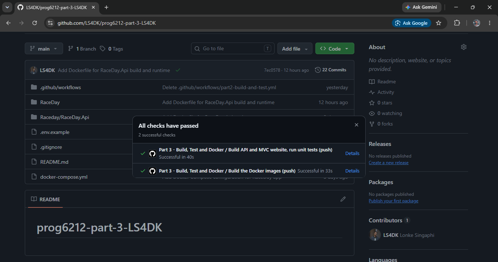

# RaceDay — Part 3 (PROG6212/w POE)

## Overview
RaceDay is an event management platform for South African road running, walking and cycling events. Part 3 completes the system: an **ASP.NET Core MVC website** that gets all of its data from the **RaceDay API** (built in Part 2), event banners and profile pictures stored in **Azure Blob Storage**, and the whole application packaged with **Docker** so it starts with a single command.

```
Browser  ->  RaceDay.Web (MVC website)  ->  RaceDay.Api (REST API)  ->  SQL Server
                                                   |
                                                   +-->  Azure Blob Storage (images)
```
The website contains no database code and never talks to Azure. Every read, write and image upload goes through the API.

## Video presentation
Unlisted YouTube link: <!-- paste your link here -->

## CI/CD
GitHub Actions runs on every push. It validates the repository structure, builds the API and the MVC website, runs all unit tests, and then builds both Docker images. Latest green run:



Workflow file: `.github/workflows/part3-build-test-docker.yml`. The structure check also fails the build if a `.env` file or an Azure storage key is ever committed.

## The two roles
- **Organiser** — dashboard with a summary of their events, enrolments per event and upcoming dates; create, edit and delete events with an optional banner image; add and remove categories; view everyone enrolled in an event and change their status (Pending, Confirmed, Cancelled); capture and correct finish times and positions.
- **Participant** — home page of upcoming events with search, type and date filters; event detail page with the banner and categories; enter an event by choosing a category; "My Enrolments" with colour-coded status; "My Results" with finish time and position (for example "47th out of 312 finishers"); profile page with name, email and profile picture.

Both roles register, log in and log out. Each role sees its own navigation menu, and pages are protected by role: someone who isn't logged in is sent to the login page, and the wrong role sees an "access denied" page.

## Run it with Docker (one command)
**Prerequisite:** Docker Desktop, running. Nothing else needs to be installed.

1. Clone the repository and open a terminal in the folder that contains `docker-compose.yml`.
2. *(Optional, only needed for image uploads)* copy `.env.example` to a new file called `.env` and put your Azure Blob Storage connection string in it (see "Azure Blob Storage" below). Without it, everything works except uploading images, and the site shows a friendly "image storage is unavailable" message.
3. Run:
   ```
   docker compose up --build
   ```
4. The first run takes several minutes (it downloads the .NET and SQL Server images). Wait for `Database is up to date.` in the log.
5. Open:
   - **Website:** http://localhost:8080
   - **API (Swagger):** http://localhost:5200/swagger

To stop, press `Ctrl+C` and run `docker compose down`. The database is kept in a Docker volume; use `docker compose down -v` to wipe it and start fresh.

What starts: a SQL Server container (`db`), the API container (`api`, creates the database tables on start-up from the EF Core migrations) and the website container (`web`, which reaches the API at `http://api:8080/` on the private Docker network).

> The default database password in `docker-compose.yml` is for local demonstration only. Set `MSSQL_SA_PASSWORD` in `.env` to change it.

## Run it without Docker (Visual Studio)
**Prerequisites:** Visual Studio with the ASP.NET workload, the .NET 10 SDK, and SQL Server (LocalDB or Express).

1. Open the solution in `RaceDay/`.
2. In `RaceDay/RaceDay.Api/appsettings.json`, check that `Server=` in `DefaultConnection` matches your SQL Server. The database is called `RaceDayPart3`.
3. In **Package Manager Console** (default project `RaceDay.Api`) run `Update-Database`.
4. *(Optional)* right-click `RaceDay.Api` → **Manage User Secrets** and add the Azure connection string:
   ```json
   { "AzureStorage": { "ConnectionString": "DefaultEndpointsProtocol=https;AccountName=lonkeraceday2026;AccountKey=WQFjvFjkvJTi1s7fFo1Ovj/9zSGp8V39VUyM58b9RA7SUpnokyd0CvPK5KXoUd5ohBIhEPdGu587+ASt3Mx7UA==;EndpointSuffix=core.windows.net" } }
   ```
5. Right-click the solution → **Configure Startup Projects** → **Multiple startup projects**, and set `RaceDay.Api` and `RaceDay.Web` to **Start**.
6. Press **F5**. If the API's HTTPS port differs from the one in `RaceDay/RaceDay.Web/appsettings.json` (`Api:BaseUrl`), update that setting.

## Azure Blob Storage
Event banners and profile pictures are stored in an Azure Blob Storage container named `raceday-images`. The API creates the container automatically the first time an image is uploaded.

1. In the Azure portal create a **Storage account** (Standard, LRS). On the **Advanced** tab tick **Allow enabling anonymous access on individual containers** so the website can show the images.
2. Open the storage account → **Security + networking → Access keys** and copy a **Connection string**.
3. Docker: put it in `.env` as `AZURE_STORAGE_CONNECTION_STRING='...'`. Visual Studio: put it in User Secrets (above).

How it works: the Organiser or Participant uploads a file on the website → the website sends it to the API → the API checks it (JPG, PNG or WebP, up to 5 MB, and the first bytes of the file must match the image type) → the API uploads it to Azure and saves the public blob URL on the event or user → the website shows the image with that URL. The connection string is never committed: it lives in `.env` (git-ignored) or User Secrets.

## Project structure
```
docker-compose.yml          Website + API + SQL Server, started together
.env.example                Template for local secrets (copy to .env)
.github/workflows/          CI workflow
RaceDay/
├── RaceDay.slnx
├── RaceDay.Api/            REST API (controllers, EF Core, migrations, Dockerfile)
├── RaceDay.Api.Tests/      Unit tests
└── RaceDay.Web/            MVC website
    ├── Controllers/        Account, Home, Events, Enrolments, Results, Profile, Dashboard, OrganiserEvents
    ├── Filters/            [RequireRole] page protection
    ├── Models/             View models and the shapes returned by the API
    ├── Services/           ApiClient (all API calls), UserSession, helpers
    ├── Views/              Razor pages
    ├── wwwroot/            CSS (RaceDay theme) and JavaScript
    └── Dockerfile
```

## How authentication works
The API keeps a server-side session with the user's ID and role. The website keeps its own session containing the user's name and role plus the API's session cookie, and `ApiClient` attaches that cookie to every API call. Passwords are hashed with PBKDF2 and a random salt and are never returned. Every form carries an anti-forgery token, and the API checks role and ownership again on every change, so the website's checks are for friendliness and the API's checks are the real security.

## Error handling
API failures become plain messages on the page, a global handler and a custom 404 page catch anything else, and if the API is unreachable the site says so instead of crashing. Buttons switch to a "please wait" state after a click, so a double-click can't submit a form twice, and protected pages are never cached, so the Back button after logging out can't reveal them.

## Unit tests
xUnit tests start the real API in memory (in-memory database and a fake image store) and call the endpoints over HTTP. They cover registration and login, event management and ownership rules, role-based access (401 and 403 on every protected endpoint), enrolments, results, event filters, image upload validation and enrolment status changes. Run them from **Test → Test Explorer** in Visual Studio, or run `dotnet test` in the `RaceDay` folder. They also run in CI.

## API endpoints (23)
| Method | Route | Who can call it |
|---|---|---|
| POST | `/api/auth/register` | Anyone |
| POST | `/api/auth/login` | Anyone |
| POST | `/api/auth/logout` | Anyone |
| GET | `/api/users/me` | Any logged-in user |
| PUT | `/api/users/me` | Any logged-in user |
| POST | `/api/users/me/picture` | Any logged-in user |
| GET | `/api/events` (filters: `search`, `eventType`, `fromDate`, `toDate`, `includePast`) | Anyone |
| GET | `/api/events/mine` | Organiser |
| GET | `/api/events/{id}` | Anyone |
| POST | `/api/events` | Organiser |
| PUT | `/api/events/{id}` | Organiser (owner) |
| POST | `/api/events/{id}/banner` | Organiser (owner) |
| DELETE | `/api/events/{id}` | Organiser (owner) |
| GET | `/api/events/{eventId}/categories` | Anyone |
| POST | `/api/events/{eventId}/categories` | Organiser (owner) |
| DELETE | `/api/categories/{id}` | Organiser (owner) |
| POST | `/api/events/{eventId}/enrolments` | Participant |
| GET | `/api/users/me/enrolments` | Participant |
| GET | `/api/events/{eventId}/enrolments` | Organiser (owner) |
| PUT | `/api/enrolments/{enrolmentId}/status` | Organiser (owner) |
| POST | `/api/enrolments/{enrolmentId}/result` | Organiser (owner) |
| PUT | `/api/enrolments/{enrolmentId}/result` | Organiser (owner) |
| GET | `/api/users/me/results` | Participant |

## Changes since the Part 1 plan and the Part 2 API
| Change | Reason |
|---|---|
| `POST /api/auth/logout` added | Users must be able to end their session. |
| `GET /api/events` returns upcoming events only, with optional `includePast`, `search`, `eventType`, `fromDate` and `toDate` | The Participant home page needs filtering. |
| `GET /api/events/mine` added | The Organiser dashboard needs the Organiser's own events with enrolment counts. |
| `POST /api/events/{id}/banner` and `POST /api/users/me/picture` added | Image uploads to Azure Blob Storage. |
| `User.ProfilePictureUrl` column added (migration `AddProfilePicture`) | Stores the profile picture URL. It is not in the Part 1 ERD. |
| `PUT /api/enrolments/{id}/status` added | Organisers can confirm, hold (Pending) or cancel an enrolment, which gives the colour-coded statuses meaning. |
| `DELETE /api/events/{id}` and `DELETE /api/categories/{id}` return 409 when enrolments exist | Protects enrolment and result history. |
| 409 responses for duplicate category names and duplicate email addresses | Backed by unique indexes. |
| Database is `RaceDayPart3` locally and `RaceDay` inside Docker | Avoids clashing with the earlier parts. The schema follows the Part 1 SQL script. |
| Column names follow the SQL script (`RoleId`, `RoleName`) rather than the ERD image | The SQL script is the executable version of the design. |

## Known limitations
Logins are held in memory, so everyone is logged out when a container restarts. The Docker log shows a harmless warning that data-protection keys are not persisted. Deleting an image's database reference does not delete the blob in Azure.

## AI tool disclosure

AI was used as a step-by-step guide. It provided explanations for how to correctly code, use and or build the API, the MVC website, the Azure Blob Storage integration, the Docker setup, the unit tests and the CI workflow. 
